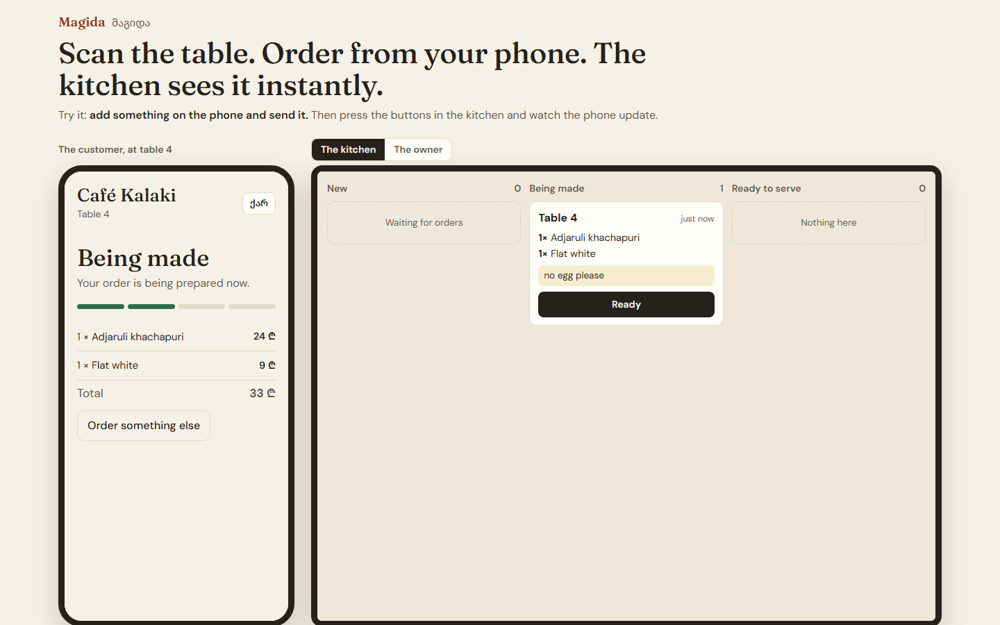
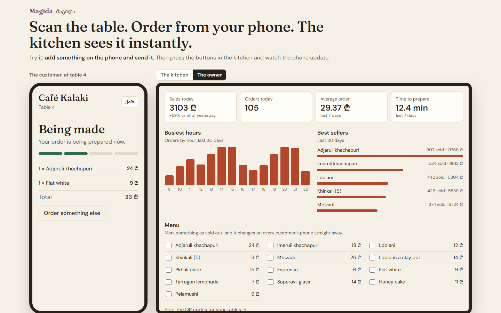
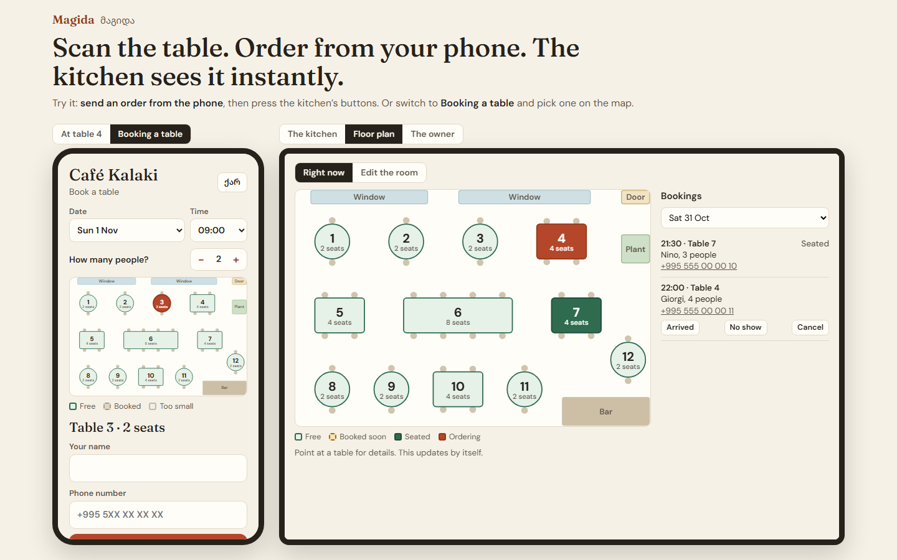
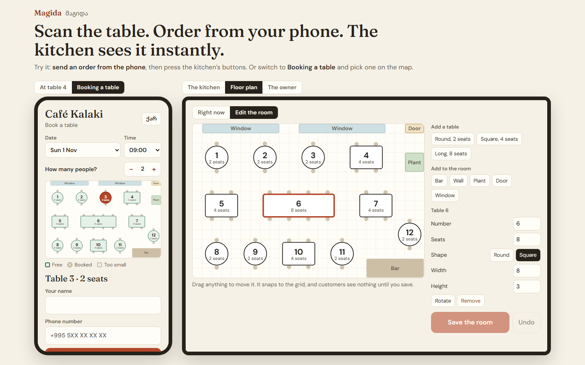

# Magida (მაგიდა, "table")

**Scan the QR code on your table, order from your phone, and the kitchen sees it instantly.**

I build websites for cafes in Tbilisi. A website doesn't solve their real problem: on a busy night, customers wait a long
time just to order, and paper tickets get lost. Magida needs no app and no new hardware beyond a tablet in the kitchen.



## Try it

You need Node.js 24 or newer.

```bash
npm install
npm run dev
```

Open <http://localhost:5173>. The home page shows the phone and the kitchen side by side, so one order shows the whole
product. Each visitor gets their own private demo cafe. Café Kalaki is made up.

## What it does

- **Customers** scan a QR code, browse the menu in English or Georgian, order, and follow their order live.
- **The kitchen** sees orders appear by themselves on a board, moves them along, and sees which ones are running late.
- **The owner** sees today's sales, best sellers and busiest hours, marks items as sold out, and prints the QR codes.
- **The room is a map.** The owner drags tables, a bar, doors and plants onto a grid to draw their own cafe.
- **Guests book a table by tapping it on that map**, and get a private link to view or cancel their booking.
- **Staff see the room live**: which tables are free, booked soon, seated or ordering. Table 4 on the map is the same table 4 as the QR code.







## How it's built

| | |
|---|---|
| **Frontend** | React, TypeScript, React Router, hand-written CSS |
| **Backend** | Node.js, Express |
| **Database** | SQLite, with hand-written SQL in [`server/repo.ts`](server/repo.ts) |
| **Live updates** | Server-Sent Events |
| **Tests** | Vitest for the API, Playwright for the browser |

## Decisions worth asking about

- **The database refuses double bookings.** Two bookings overlap if each starts before the other ends, and a SQL trigger
  ([`no_double_booking`](server/db.ts)) rejects that on insert. So a bug in the code above it still can't book one table
  twice. A larger system on Postgres would use an exclusion constraint for the same job.
- **The browser and server share the floor plan rules.** [`shared/floor.ts`](shared/floor.ts) gives the owner instant
  warnings about overlapping tables, then the server runs the same check again, because a browser can't be trusted.
- **Guests' details stay private.** The public map only learns which tables are taken, never who booked them.
- **The server sets the prices.** The browser only sends item IDs and quantities, so editing a request can't change what
  you pay.
- **A double tap sends one order.** Each order carries a unique key, and the database refuses a second order with the
  same key. That matters on bad cafe wifi, where people tap again and browsers retry.
- **Old orders keep their old prices.** Names and prices are copied onto the order, so changing the menu can't rewrite
  last month's sales.
- **Orders can only move forward.** The server rejects steps like taking a served meal back to "being made".
- **Money is whole tetri.** Storing 2400 rather than 24.00 avoids rounding errors.
- **Server-Sent Events, not WebSockets.** Updates only flow from the server to the screens, and orders go through normal
  requests, so the simpler tool is enough. Browsers also reconnect by themselves.

## What it doesn't do yet

Customers pay at the counter, because there are no online payments. It hasn't been used in a real cafe yet. Demo cafes are
deleted after a few hours. Bookings are a fixed 90 minutes during fixed opening hours, with no deposits, SMS reminders or
waiting list, and tables can't be joined together for a big group.

## Tests

```bash
npm test           # 56 API tests
npm run test:e2e   # 12 browser tests
```

## License

MIT © 2026 Luka Lomadze
